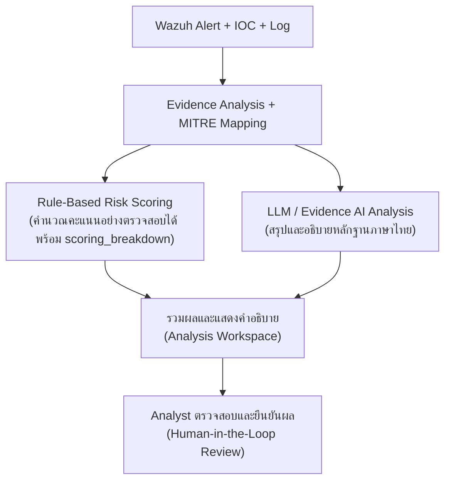

# SentinelAI — AI-Assisted Security Alert Analysis and Rule-Based Risk Prioritization
**แพลตฟอร์มวิเคราะห์การแจ้งเตือนภัยคุกคามทางไซเบอร์ด้วย AI และจัดลำดับความเสี่ยงตามกฎอย่างตรวจสอบได้ (AI-Assisted Security Alert Analysis and Rule-Based Risk Prioritization) แบบใช้งานง่าย ไม่ต้อง Login หรือสมัครสมาชิก และจัดการข้อมูลแบบ Temporary Session**

**SentinelAI** เป็นแพลตฟอร์ม AI สำหรับช่วยวิเคราะห์และจัดลำดับความสำคัญของการแจ้งเตือนภัยคุกคามทางไซเบอร์ (Security Alerts) โดยผู้ใช้งานสามารถนำเข้าไฟล์แจ้งเตือนจาก **Wazuh** (JSON หรือ CSV) หรือกรอกข้อมูล Alert ด้วยตนเอง ให้ระบบประเมินความเสี่ยง วิเคราะห์เหตุการณ์ และแสดงผลเพื่อช่วยให้ผู้ดูแลระบบตัดสินใจตรวจสอบได้ง่ายขึ้น โดยเน้นหลักการ **Human-in-the-Loop** (AI ทำหน้าที่เป็นเครื่องมือช่วยวิเคราะห์ แต่การตัดสินใจสุดท้ายยังเป็นของผู้ใช้งาน)

ระบบออกแบบในรูปแบบ **4 หน้าหลัก (ไม่ต้องมีเลขนำหน้าเมนู)** ไม่ต้องเข้าสู่ระบบหรือสมัครสมาชิก และจัดเก็บข้อมูลเฉพาะในช่วงการใช้งานปัจจุบัน (**Temporary Session**) เมื่อผู้ใช้งานดาวน์โหลดรายงาน PDF / CSV และกด **End Session (สิ้นสุด Session)** ระบบจะลบข้อมูลชั่วคราวทั้งหมดรวมถึง **Session Audit Log** ทันที

---

## 1. วิธีการใช้งานระบบ SentinelAI (6 ขั้นตอนหลัก)

1. **นำเข้าข้อมูล (Upload Alerts)**
   - ผู้ใช้งานเลือกอัปโหลดไฟล์ **JSON** หรือ **CSV** ที่ส่งออกมาจาก Wazuh หรือกรอกข้อมูล Alert ด้วยตนเองในหน้า **`Dashboard & Upload`** จากนั้นระบบจะตรวจสอบรูปแบบและความถูกต้องของข้อมูล (Validation & Deduplication)
2. **เลือก Alert ที่ต้องการวิเคราะห์ (Select Alert)**
   - ระบบแสดงรายการ Alert ทั้งหมดใน Session ปัจจุบันเพื่อให้ผู้ใช้งานเลือกเหตุการณ์ที่ต้องการตรวจสอบ เช่น ประเภทเหตุการณ์ ระดับความรุนแรงเบื้องต้น IP Address และเวลาเกิดเหตุ
   - กรณีอัปโหลดไฟล์ CSV ที่มีหลายรายการ (เช่น 100 Alerts) ผู้ใช้งานสามารถเลือกวิเคราะห์ทีละรายการ และสลับไปเลือก Alert อื่นจากไฟล์เดียวกันได้ทันทีโดยไม่ต้องอัปโหลดไฟล์ใหม่
3. **วิเคราะห์และประเมินความเสี่ยง (AI Analysis)**
   - เมื่อผู้ใช้งานเลือก Alert และกดปุ่ม **Analyze** ในหน้า **`Analysis Workspace`** ระบบจะประมวลผลข้อมูลตามลำดับ ดังนี้:
     - **Data Normalization**: จัดรูปแบบข้อมูลให้อยู่ในโครงสร้างมาตรฐานเดียวกัน
     - **Risk Scoring**: คำนวณคะแนนความเสี่ยง (`0–100`) จากความรุนแรงและพฤติกรรมที่ตรวจพบ
     - **AI Analysis**: สรุปเหตุการณ์และอธิบายสาเหตุที่ควรตรวจสอบภาษาไทยพร้อมอ้างอิงหลักฐาน
     - **MITRE ATT&CK Mapping**: เชื่อมโยงเหตุการณ์กับเทคนิคและกลยุทธ์การโจมตีในกรอบ MITRE ATT&CK
     - **Prioritization**: จัดลำดับความสำคัญของเหตุการณ์ (`Critical`, `High`, `Medium`, `Low`)
4. **ตรวจสอบและยืนยันผล (Analyst Review — Human-in-the-Loop)**
   - ผู้ใช้งานตรวจสอบผลลัพธ์ที่ได้จาก AI ในหน้า **`Analyst Review & Audit`** โดยสามารถ:
     - **พิมพ์ชื่อผู้ตรวจสอบ / ผู้อนุมัติ (Analyst / Reviewer)** ลงในช่องกรอกชื่อได้โดยตรง
     - **ปรับระดับความเสี่ยง (`CRITICAL`, `HIGH`, `MEDIUM`, `LOW`)** ผ่านเมนู Dropdown และปรับคะแนน **Risk Score (`0–100`)**
     - เลือกสถานะการตรวจสอบ (`Approved`, `Rejected`, `Needs Re-analysis`, `Escalate IR`, `False Positive`) เพิ่มหมายเหตุความคิดเห็น และแนบรูปภาพหลักฐานยืนยันจุดน่าสงสัยของแต่ละเหตุการณ์
     - ทุกการตรวจสอบและแก้ไขจะถูกบันทึกไว้ใน **Session Audit Log** ของ Session ปัจจุบัน
5. **สร้างรายงาน (Generate Report)**
   - เมื่อยืนยันผลการวิเคราะห์แล้ว ผู้ใช้งานสามารถเปิดหน้า **`Report`** เพื่อดูตัวอย่างรายงานและดาวน์โหลดรายงานในรูปแบบ **PDF** หรือ **CSV** ซึ่งประกอบด้วยข้อมูล Alert, คะแนนความเสี่ยง, ผลการวิเคราะห์จาก AI, ข้อมูล MITRE ATT&CK, รูปภาพหลักฐานจุดน่าสงสัย และผลการตรวจสอบของผู้ใช้งาน (รวมถึงรองรับปุ่ม **Save Report** สำหรับเก็บเฉพาะรายงานที่ต้องการบันทึกไว้)
6. **สิ้นสุดการใช้งาน (End Session)**
   - ระบบไม่ต้องการการเข้าสู่ระบบหรือสมัครสมาชิก และจะเก็บข้อมูลเฉพาะในช่วงการใช้งานปัจจุบัน (**Temporary Session**)
   - เมื่อเสร็จสิ้น ผู้ใช้งานกดปุ่ม **End Session (สิ้นสุด Session)** บนแถบด้านบนหรือในหน้า **`Report`** ระบบจะลบข้อมูลชั่วคราวที่เกี่ยวข้องกับการวิเคราะห์ทั้งหมด รวมถึง **Session Audit Log** โดยผู้ใช้งานยังคงเก็บไฟล์รายงาน PDF / CSV ที่ดาวน์โหลดไว้ได้

---

## 2. หน้าหลักของระบบ (4 หน้าหลัก)

| หน้าหลักในเมนู (Sidebar) | หน้าที่และการทำงานหลัก |
| :--- | :--- |
| **`Dashboard & Upload`** | แสดงภาพรวมข้อมูล Alert ใน Session ปัจจุบัน (`Total Alerts`, `Critical`, `High`, `Medium`, `Low`, กราฟสรุปผล) และส่วนอัปโหลดไฟล์ JSON / CSV หรือกรอกข้อมูล Alert ด้วยตนเอง |
| **`Analysis Workspace`** | เลือก Alert จากตารางใน Session กดปุ่ม **Analyze** และดูรายละเอียดเหตุการณ์ (`Alert Details`), คะแนนความเสี่ยง (`Risk Score`), ผลวิเคราะห์ AI (`AI Analysis`), ข้อมูล `MITRE ATT&CK Mapping` และการแนบรูปภาพจุดน่าสงสัยในหน้าเดียว |
| **`Analyst Review & Audit`** | ตรวจสอบผลวิเคราะห์ของ AI พิมพ์ชื่อผู้ตรวจสอบ ปรับระดับความเสี่ยงผ่าน Dropdown เพิ่มหมายเหตุ แนบรูปภาพหลักฐาน ยืนยันหรือแก้ไขผล และดูประวัติการใช้งานใน Session ปัจจุบัน (**Session Audit Log**) |
| **`Report`** | แสดงตัวอย่างรายงาน ดาวน์โหลดรายงานในรูปแบบ **PDF** หรือ **CSV** และกดปุ่ม **End Session** เพื่อสิ้นสุด Session และลบข้อมูลชั่วคราวทั้งหมด |

---

## 3. เทคโนโลยีและเครื่องมือที่ใช้ (Tech Stack & Libraries)

| ส่วนการทำงาน (Layer) | เทคโนโลยี / ไลบรารีที่ใช้ | หน้าที่และการทำงาน |
| :--- | :--- | :--- |
| **Frontend UI** | **React 18 + TypeScript** | พัฒนาเว็บแอปพลิเคชันแบบ Single-Page Application (SPA) 4 หน้าหลัก |
| **Styling & Theme** | **Tailwind CSS + Lucide React Icons** | ออกแบบ UI สไตล์ High-Contrast Frosted Glass (เปิดเป็นธีมสว่าง Light Mode เป็นค่าเริ่มต้น และสลับเป็นโหมดมืด Dark Mode ได้ทันที) |
| **Data Visualization** | **Recharts** | แสดงกราฟสถิติการแจ้งเตือน (Alert Trend, Severity Distribution, MITRE Tactics, Source Breakdown) |
| **Frontend Build / Dev Server** | **TypeScript (`tsc`) + Custom Node ESM Bundler (`dev-server.mjs`)** | คอมไพล์และรัน Dev Server บนพอร์ต `3000` พร้อม Proxy ไปยัง `/api` ที่พอร์ต `8080` |
| **Backend API Framework** | **Python 3 + FastAPI + Uvicorn** | ให้บริการ RESTful API สำหรับ Ingest, Analyze, Review, Audit Log, Evidence Images และ End Session Cleanup พร้อม Swagger Docs (`/docs`) |
| **ORM & Data Validation** | **SQLAlchemy 2.0 + Pydantic v2** | จัดการโครงสร้างฐานข้อมูลและตรวจสอบความถูกต้องของข้อมูล (Schema Validation) |
| **Database & Storage** | **SQLite (`sentinelai.db`) / PostgreSQL 16** | จัดเก็บข้อมูลระหว่าง Session และลบข้อมูลชั่วคราวรวมถึง Session Audit Log เมื่อกด End Session |
| **AI & Threat Analysis** | **Deterministic Rule Engine + Hybrid AI Engine + MITRE Mapper** | คำนวณ Risk Score (0–100) รองรับ Wazuh Rule Level 0–16, สกัด IOC, จับคู่ MITRE ATT&CK และสรุปผลวิเคราะห์ภาษาไทยพร้อมอ้างอิงหลักฐาน (`evidence_citations`) |
| **Automated Testing** | **Pytest (`TC01`–`TC14`)** | ทดสอบการนำเข้าข้อมูล, Deduplication, Risk Score (Wazuh Level 0–16, IOC Credibility, Context-Aware Classification), AI Analysis, MITRE Mapping และการจัดการข้อมูล |

---

## 4. สถาปัตยกรรม AI ที่ใช้ในระบบ (Hybrid Evidence-Grounded AI Engine)

ระบบ **SentinelAI** ออกแบบด้วยสถาปัตยกรรม **Hybrid Evidence-Grounded AI Engine** (กำหนดไว้ในไฟล์ [config.py](file:///d:/fightikeeee/backend/app/core/config.py) และ [analyzer.py](file:///d:/fightikeeee/backend/app/ai_engine/analyzer.py)) โดยแยกส่วนการคำนวณคะแนนความเสี่ยง (**Deterministic Rule Engine**) ออกจากส่วนการสรุปและอธิบายเหตุการณ์ด้วย AI เพื่อป้องกันปัญหา AI คำนวณคะแนนเพี้ยนหรือสร้างข้อมูลเท็จ (Zero Hallucination) และรองรับการทำงาน **4 โหมด** ดังนี้:

| โหมด AI (`AI_PROVIDER`) | โมเดล / เอนจินที่ใช้ | รายละเอียดการทำงานและการตั้งค่า |
| :--- | :--- | :--- |
| **`mock`** *(ค่าเริ่มต้น)* | **Built-in Deterministic Evidence AI Engine** | เอนจินวิเคราะห์หลักฐานเชิงพฤติกรรมในตัวเครื่อง ไม่ต้องใช้อินเทอร์เน็ตและไม่ต้องใช้ API Key สกัดหลักฐานจาก `Raw Log`, `Command Line`, `IOC Threat Intel` และ `MITRE ATT&CK` เพื่อวิเคราะห์รูปแบบการโจมตี (เช่น Ransomware, Mimikatz LSASS Dump, SQL Injection, PowerShell EncodedCommand, Brute Force, Lateral Movement, Data Exfiltration) พร้อมสร้างสรุปภาษาไทยและขั้นตอนการแก้ไขทันที |
| **`gemini`** | **Google Gemini (`gemini-2.5-flash`)** | เชื่อมต่อ Google Gemini API โดยตั้งค่า `AI_PROVIDER=gemini` และระบุ `GEMINI_API_KEY` ในไฟล์ `.env` |
| **`openai`** | **OpenAI (`gpt-4o-mini`)** | เชื่อมต่อ OpenAI Chat Completions API โดยตั้งค่า `AI_PROVIDER=openai` และระบุ `OPENAI_API_KEY` ในไฟล์ `.env` |
| **`ollama`** | **Ollama Local LLM (`llama3.1`)** | เชื่อมต่อ Local LLM ที่รันภายในเครื่องหรือเซิร์ฟเวอร์องค์กร (`http://localhost:11434`) โดยตั้งค่า `AI_PROVIDER=ollama` เหมาะสำหรับงาน SOC ที่ต้องการความเป็นส่วนตัวของข้อมูลสูง (On-Premise / Air-Gapped) ไม่ส่ง Log ออกนอกองค์กร |

> **ระบบ Fallback อัตโนมัติ:** หากตั้งค่าใช้ LLM ภายนอก (`gemini`, `openai`, `ollama`) แล้วเครือข่ายขัดข้องหรือ API Key ไม่พร้อมใช้งาน ระบบจะสลับกลับมาใช้ **Built-in Deterministic Evidence AI Engine** ให้อัตโนมัติเพื่อให้การวิเคราะห์ของ SOC ไม่สะดุด

### หลักการคิดวิเคราะห์และแหล่งอ้างอิงวิธีแก้ไข (How Built-in Evidence AI Engine Works)
ตัว **`Built-in Deterministic Evidence AI Engine`** ([analyzer.py](file:///d:/fightikeeee/backend/app/ai_engine/analyzer.py)) ทำงานในรูปแบบ **Rule-Based Expert System + Dynamic Telemetry Injection** (ระบบผู้เชี่ยวชาญที่ดึงข้อมูลจริงจาก Log มาประกอบเข้ากับคู่มือรับมือภัยคุกคามมาตรฐานสากล) โดยอ้างอิงจาก 3 มาตรฐานหลักของงาน SOC ดังนี้:

1. **อ้างอิงขั้นตอนการแก้ไขและระงับเหตุจากมาตรฐาน NIST SP 800-61 (Computer Security Incident Handling Guide) และ SANS Incident Handler's Handbook:**
   - ทุกคำแนะนำการแก้ไข (`recommendations`) จะถูกจัดเรียงตามลำดับการรับมือเหตุการณ์ 4 ขั้นตอนเสมอ ได้แก่:
     - **Containment (จำกัดวงความเสียหายทันที):** เช่น การสั่งแยกเครื่องออกจากเครือข่าย (`Network Isolation`) หรือระงับสิทธิ์บัญชีผู้ใช้ชั่วคราว (`Disable Account`)
     - **Investigation & Forensics (ตรวจสอบหลักฐานและหาขอบเขต):** เช่น การตรวจสอบ Windows/Sysmon Event ID (`4624`, `4104`, `7045`, `5140`), การถอดรหัสคำสั่ง Base64, การตรวจ DNS/Firewall Logs หรือการค้นหา `file_hash` บนเครื่องอื่นในวงแลน
     - **Eradication (กำจัดต้นตอของภัยคุกคาม):** เช่น การบังคับรีเซ็ตรหัสผ่าน (`Force Password Reset`), การล้าง Kerberos Golden/Silver Ticket, การบล็อก IP/Domain บน WAF/Firewall หรือการแก้ไขโค้ดเป็น Parameterized Queries
     - **Recovery & Hardening (กู้คืนระบบและป้องกันการเกิดซ้ำ):** เช่น การกู้คืนจาก Offline Backup, การเปิดใช้งาน Credential Guard / LSA Protection (`RunAsPPL`) หรือการตั้งค่า Fail2Ban / Account Lockout Policy

2. **อ้างอิงรูปแบบพฤติกรรมการโจมตีจาก MITRE ATT&CK Framework (Enterprise Matrix) และ Wazuh / Sigma Detection Rules:**
   - เชื่อมโยงผลลัพธ์จากโมดูล [mapper.py](file:///d:/fightikeeee/backend/app/mitre_mapping/mapper.py) เพื่อจับคู่คำสั่งและพฤติกรรมใน Log เข้ากับเทคนิคของ MITRE ATT&CK แล้วเลือก Playbook การรับมือที่ตรงกับประเภทภัยคุกคาม เช่น:
     - **`T1486 / T1490` (Ransomware & Shadow Copy Deletion):** ตรวจพบคำสั่ง `vssadmin delete shadows` หรือการเข้ารหัสไฟล์ (`.lockbit`)
     - **`T1003.001` (LSASS Credential Dumping / Mimikatz):** ตรวจพบการเข้าถึงหน่วยความจำของโปรเซส `lsass.exe`
     - **`T1059.001` (PowerShell EncodedCommand Execution):** ตรวจพบการรัน `powershell.exe` แบบซ่อนหน้าต่างและเข้ารหัส Base64 (`-Enc`) เพื่อดึงสคริปต์จาก C2
     - **`T1190` (Exploit Public-Facing Application / SQL Injection):** ตรวจพบ Payload แบบ `UNION SELECT` ที่ดึงข้อมูลจากฐานข้อมูล
     - **`T1110` (Credential Brute Force):** ตรวจพบความพยายามล็อกอินล้มเหลวซ้ำๆ อย่างต่อเนื่อง
     - **`T1548.003` (Sudo Privilege Escalation):** ตรวจพบบัญชีบริการรัน `sudo` เพื่อเข้าถึงไฟล์สำคัญ เช่น `/etc/shadow`
     - **`T1021.002 / T1569.002` (Lateral Movement / PsExec):** ตรวจพบการติดตั้งและรันบริการรีโมตข้ามเครื่องภายในเครือข่าย
     - **`T1041 / T1071.004` (Exfiltration Over C2 / DNS Tunneling):** ตรวจพบการส่งข้อมูลออกนอกองค์กรในปริมาณผิดปกติ

3. **การดึงตัวแปรจริงจาก Log มาประกอบเป็นคำแนะนำเฉพาะเจาะจง (Dynamic Evidence Grounding):**
   - ระบบไม่ได้ใช้ข้อความสำเร็จรูปตายตัว แต่จะดึงค่าตัวแปรจริงที่สกัดได้จาก Alert นั้นๆ ได้แก่ ชื่อเครื่องเป้าหมาย (`hostname`), IP ต้นทางและปลายทาง (`src_ip`, `dst_ip`), บัญชีผู้ใช้ (`username`), ชื่อโปรเซสและคำสั่งที่รัน (`process_name`, `command_line`), โดเมนหรือค่าแฮชของไฟล์ (`domain`, `file_hash`), ผลตรวจ `IOC Threat Intel` ([ioc_enrichment.py](file:///d:/fightikeeee/backend/app/services/ioc_enrichment.py)) และคะแนนแต่ละปัจจัยจาก `Rule Engine` ([evaluator.py](file:///d:/fightikeeee/backend/app/rule_engine/evaluator.py)) มาสร้างเป็นคำอธิบายและขั้นตอนการแก้ไขที่ระบุชื่อเครื่อง ชื่อผู้ใช้ และ IP ของเหตุการณ์นั้นโดยตรง

### แผนผังสถาปัตยกรรมการประมวลผล (AI-Assisted Security Alert Analysis & Rule-Based Risk Prioritization Pipeline)
ระบบแยกส่วนการคำนวณคะแนนตามกฎที่ตรวจสอบได้ (**Rule-Based Risk Scoring** พร้อม `scoring_breakdown`) ออกจากส่วนการสรุปและอธิบายหลักฐานด้วย **LLM / Evidence AI Engine** ดังแผนภาพต่อไปนี้:



### กลไกความแม่นยำและการป้องกันข้อผิดพลาดของ Rule-Based Risk Scoring ([evaluator.py](file:///d:/fightikeeee/backend/app/rule_engine/evaluator.py))
1. **รองรับ Wazuh Rule Level ครบตามมาตรฐานจริง (`0–16`):** รองรับระดับ `0` (Ignored/0 คะแนน) ถึงระดับ `16` (ระดับสูงสุดของ Wazuh)
2. **คะแนน MITRE ต้องมีหลักฐานยืนยัน (`Evidence-Verified MITRE Scoring`):** ไม่ให้คะแนนเต็มเพียงเพราะมีรหัส MITRE แต่ตรวจสอบว่ามีหลักฐานใน Log รองรับและสอดคล้องกับความรุนแรงของเหตุการณ์
3. **การจำแนกด้วยบริบท ไม่ดูแค่คำสำคัญเดี่ยวๆ (`Context-Aware Classification`):**
   - แยกการใช้งาน **PowerShell ปกติของแอดมิน (`Administrative PowerShell Activity`)** ออกจาก **PowerShell อันตรายที่มีการเข้ารหัสหรือดึงมัลแวร์ (`-enc`, `encodedcommand`, `-w hidden`, `downloadstring`, `c2`)**
   - แยกการอ่านไฟล์ **`/etc/shadow` (`Privilege Escalation`)** ออกจากคำสั่ง **`vssadmin delete shadows` (`Ransomware`)**
4. **ตรวจสอบแหล่งที่มา ความเชื่อมั่น และความสดใหม่ของ IOC (`IOC Credibility & Freshness`):** ตรวจสอบว่า IOC มาจากแหล่งที่เชื่อถือได้ (`AbuseIPDB`, `VirusTotal`, `ThreatFox`, `URLhaus` ฯลฯ), มี `confidence_score >= 70%` และข้อมูลยังไม่เก่าเกิน `90 วัน`
5. **การหักคะแนนงานบำรุงรักษาต้องมีหลักฐานยืนยัน (`Verified Maintenance Guard`):** คำว่า `scheduled maintenance` จะไม่ลดคะแนนทันทีหากไม่มีหลักฐานยืนยันว่าเป็นบัญชีหรือกฎงานบำรุงรักษาที่ได้รับอนุญาต (`backup_svc`, `rule #5501`) และจะไม่ลดคะแนนเด็ดขาดหากพบ IOC หรือ Payload อันตราย
6. **เพดานคะแนนแต่ละหมวดหมู่ (`Category Sub-Caps`) พร้อม `scoring_breakdown`:** จำกัดเพดานคะแนนแยกตามหมวด (`Rule Level <= 42`, `IOC <= 28`, `MITRE <= 22`, `Behavioral Modifiers <= 25`) เพื่อไม่ให้คะแนนพุ่งสูงเกินจริง และแสดงตาราง `scoring_breakdown` ให้ผู้ใช้เห็นที่มาของคะแนนทุกปัจจัยอย่างโปร่งใส

---

## 5. โครงสร้างโฟลเดอร์และตำแหน่งไฟล์ทั้งหมด (Project Directory & File Map)

```text
d:\fightikeeee\
├── README.md                                  # เอกสารภาพรวมระบบ ขั้นตอนการใช้งาน 6 ขั้นตอน โครงสร้าง 4 หน้าหลัก และคู่มือการรัน
├── docker-compose.yml                         # ไฟล์ตั้งค่า Docker Compose (PostgreSQL 16 + FastAPI Backend + Frontend)
│
├── datasets\                                  # ชุดข้อมูลตัวอย่างสำหรับทดสอบนำเข้าและวิเคราะห์
│   ├── sample_wazuh_alerts.json               # ข้อมูลตัวอย่าง Wazuh Security Alerts รูปแบบ JSON
│   ├── sample_security_logs.csv               # ข้อมูลตัวอย่าง Network / Host Security Logs รูปแบบ CSV
│   └── evaluation_ground_truth.json           # ข้อมูลเฉลย Ground-Truth สำหรับคำนวณ Precision / Recall / F1-Score
│
├── docs\                                      # เอกสารประกอบโครงงาน
│   ├── proposal.md                            # ข้อเสนอโครงงานและแผนการดำเนินงาน (Project Proposal & Roadmap)
│   ├── requirements_srs.md                    # เอกสาร SRS โครงสร้าง 4 หน้าหลัก และข้อกำหนดฟังก์ชัน FR-01 ถึง FR-06
│   ├── architecture.md                        # แผนภาพสถาปัตยกรรมและ Sequence Diagram ของ Temporary Session Workflow
│   ├── test_report.md                         # รายงานผลการทดสอบระบบ (Test Cases & Evaluation Metrics)
│   └── user_manual.md                         # คู่มือการติดตั้งและวิธีการใช้งานระบบ SentinelAI ครบ 6 ขั้นตอน
│
├── backend\                                   # ระบบหลังบ้าน (Python + FastAPI + SQLAlchemy)
│   ├── Dockerfile                             # Dockerfile สำหรับสร้างอิมเมจ Backend
│   ├── requirements.txt                       # รายการแพ็กเกจ Python ที่ใช้งาน
│   ├── sentinelai.db                          # ไฟล์ฐานข้อมูล SQLite สำหรับโหมด Local Development
│   ├── app\
│   │   ├── __init__.py                        # ตัวจัดการ Pure-Python Loader รองรับ Windows App Control Policy
│   │   ├── main.py                            # จุดเริ่มต้นของ FastAPI, ตั้งค่า CORS, สร้างตาราง และ Seed ข้อมูลตัวอย่างเริ่มต้น
│   │   ├── core\
│   │   │   ├── config.py                      # ตั้งค่าตัวแปรแวดล้อม (DATABASE_URL, AI_PROVIDER, IOC_MODE, พาธโฟลเดอร์)
│   │   │   └── database.py                    # การเชื่อมต่อฐานข้อมูล SQLAlchemy Engine และ SessionLocal
│   │   ├── models\
│   │   │   ├── alert.py                       # โมเดลฐานข้อมูล (SecurityAlert, AlertAnalysis, AnalystReviewRecord, AuditLog, ImportHistory ฯลฯ)
│   │   │   └── schemas.py                     # Pydantic Schemas สำหรับตรวจสอบ Request / Response ของทุก Endpoint
│   │   ├── api\
│   │   │   └── routes.py                      # รวม API Endpoints ทั้งหมด (Ingest JSON/CSV, Reanalyze, Analyst Decision, Evidence Images, Clear Temporary Session)
│   │   └── services\
│   │       ├── normalizer.py                  # Module 1: ตรวจสอบความสมบูรณ์ แปลงโครงสร้าง JSON/CSV และคำนวณ SHA-256 Deduplication
│   │       ├── ioc_enricher.py                # Module 2: สกัดและตรวจสอบ IP, Domain, File Hash กับฐานข้อมูล Threat Intel
│   │       ├── ai_analyzer.py                 # Module 3: วิเคราะห์ Alert ด้วย AI สรุปเหตุการณ์ภาษาไทยพร้อมแนบหลักฐาน (evidence_citations)
│   │       ├── risk_engine.py                 # Module 4A: คำนวณ Risk Score (0-100) และจัดระดับความสำคัญ (Critical / High / Medium / Low)
│   │       ├── mitre_mapper.py                # Module 4B: จับคู่พฤติกรรมการโจมตีเข้ากับ MITRE ATT&CK Technique & Tactic
│   │       ├── triage_pipeline.py             # ตัวประสานงาน Pipeline ทั้งหมด (Data Normalization -> Risk Scoring -> AI Analysis -> MITRE Mapping)
│   │       └── evaluator.py                   # คำนวณค่าความแม่นยำ Precision, Recall, F1-Score เทียบกับ Ground Truth
│   └── tests\
│       └── test_sentinel.py                   # ชุดทดสอบอัตโนมัติ 13 ข้อ (TC01–TC13)
│
└── frontend\                                  # ระบบหน้าบ้าน (React 18 + TypeScript + Tailwind CSS)
    ├── Dockerfile                             # Dockerfile สำหรับสร้างอิมเมจ Frontend
    ├── package.json                           # รายการ Dependencies และคำสั่งสคริปต์ (npm run dev, npm run build)
    ├── dev-server.mjs                         # Custom Node Dev Server (พอร์ต 3000) & Production Bundler
    ├── index.html                             # ไฟล์ HTML หลักของเว็บแอปพลิเคชัน
    └── src\
        ├── main.tsx                           # จุดเริ่มต้นการเรนเดอร์ React Application
        ├── App.tsx                            # ตัวจัดการสถานะหลักและหน้าจอทั้ง 4 หน้า (Dashboard & Upload, Analysis Workspace, Analyst Review & Audit, Report)
        ├── types\
        │   └── index.ts                       # TypeScript Interfaces ทั้งหมด (SecurityAlert, AlertAnalysis, AuditLog, EvidenceImageAttachment ฯลฯ)
        ├── services\
        │   └── api.ts                         # ฟังก์ชันเรียกใช้งาน REST API ทั้งหมด
        ├── utils\
        │   ├── formatDateTime.ts              # ฟังก์ชันแปลงวันและเวลาเป็นรูปแบบภาษาไทย (UTC+7, ไม่มีวินาที)
        │   └── reportExporter.ts              # ระบบส่งออกรายงานเป็นไฟล์ CSV และหน้าต่างพิมพ์รายงาน PDF พร้อมรูปภาพหลักฐาน
        ├── components\
        │   └── SeverityBadge.tsx              # คอมโพเนนต์ป้ายแสดงระดับความเสี่ยง (Severity) และสถานะการตรวจสอบ (Review Status)
        ├── partials\
        │   ├── Sidebar.tsx                    # แถบเมนูด้านซ้ายแสดง 4 หน้าหลักโดยไม่มีตัวเลขนำหน้า
        │   └── Header.tsx                     # แถบด้านบนแสดงสถานะระบบ, เวลาปัจจุบัน, ค้นหาด่วน, ปุ่ม End Session และสลับธีมมืด/สว่าง
        └── pages\                             # คอมโพเนนต์ของทั้ง 4 หน้าหลัก
            ├── IngestPage.tsx                 # ส่วนนำเข้าข้อมูลในหน้า Dashboard & Upload (อัปโหลด JSON/CSV, กรอก Alert เอง, ตรวจสอบข้อมูล)
            ├── SecurityAlertsPage.tsx         # ส่วนตารางเลือก Alert และแสดงรายละเอียดเหตุการณ์ในหน้า Analysis Workspace
            ├── AlertDetailPage.tsx            # ส่วนผลวิเคราะห์ AI, Risk Score Breakdown, MITRE ATT&CK และแนบรูปภาพจุดน่าสงสัยในหน้า Analysis Workspace
            ├── AnalystReviewPage.tsx          # ส่วนตรวจสอบผล พิมพ์ชื่อผู้ตรวจสอบ ปรับระดับความเสี่ยง เพิ่มหมายเหตุ และแนบรูปหลักฐานในหน้า Analyst Review & Audit
            ├── AuditTrailPage.tsx             # ส่วนแสดงประวัติการใช้งานใน Session ปัจจุบัน (Session Audit Log) ในหน้า Analyst Review & Audit
            └── ReportsPage.tsx                # หน้า Report สำหรับแสดงตัวอย่างรายงาน ดาวน์โหลด PDF / CSV และกดปุ่ม End Session
```

---

## 6. เอกสารประกอบโครงการ (Project Documentation)
- [Project Proposal & Roadmap](file:///d:/fightikeeee/docs/proposal.md)
- [Software Requirement Specification (SRS)](file:///d:/fightikeeee/docs/requirements_srs.md)
- [System Architecture & Temporary Session Workflow Diagram](file:///d:/fightikeeee/docs/architecture.md)
- [Test Cases (TC01–TC13) & Evaluation Metrics Report](file:///d:/fightikeeee/docs/test_report.md)
- [Installation Guide & SOC User Manual](file:///d:/fightikeeee/docs/user_manual.md)

---

## 7. การเริ่มต้นใช้งานอย่างรวดเร็ว (Quick Start)

### วิธีที่ 1: รันบนเครื่องแบบ Local (FastAPI พอร์ต 8080 + Frontend Dev Server พอร์ต 3000)

1. **รันชุดทดสอบอัตโนมัติ (13 Test Cases) และเปิดเซิร์ฟเวอร์ Backend:**
   ```powershell
   cd d:\fightikeeee\backend
   python -m pytest -q
   python -m uvicorn app.main:app --host 127.0.0.1 --port 8080
   ```

2. **เปิดเซิร์ฟเวอร์ Frontend (ในอีกหน้าต่าง Terminal):**
   ```powershell
   cd d:\fightikeeee\frontend
   npm run dev
   ```

3. **เข้าใช้งานผ่านเบราว์เซอร์:**
   - เว็บแอปพลิเคชัน (Dev Server): **`http://localhost:3000`**
   - เว็บแอปพลิเคชัน (ผ่าน FastAPI Static Bundle): **`http://localhost:8080`**
   - เอกสาร REST API (Swagger UI): **`http://localhost:8080/docs`**

### วิธีที่ 2: รันด้วย Docker Compose
```powershell
cd d:\fightikeeee
docker compose up --build -d
```
