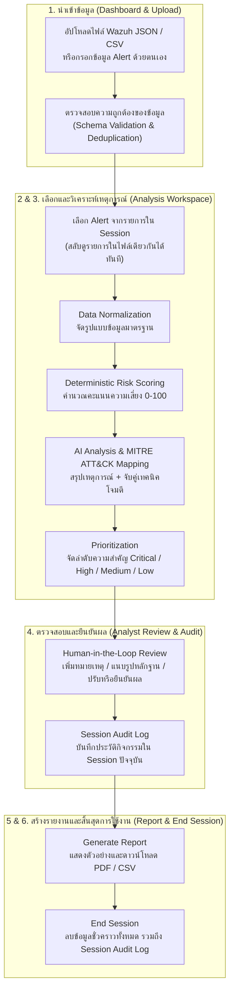
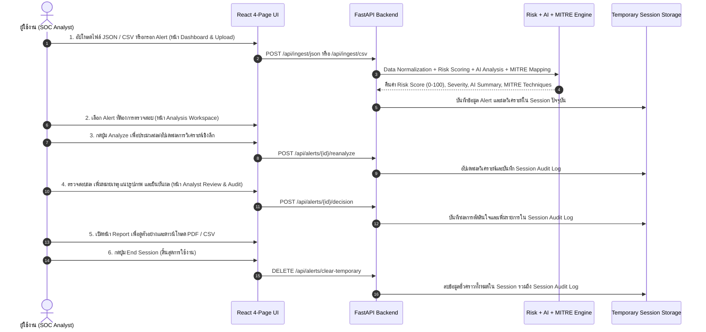

# System Architecture & Workflow Design — SentinelAI

## 1. สถาปัตยกรรมระบบและลำดับการทำงาน (System Architecture & 6-Step Workflow)
สถาปัตยกรรมของ **SentinelAI** ออกแบบให้รองรับการทำงานแบบ **Temporary Session Workflow (ไม่ต้อง Login หรือสมัครสมาชิก)** ผ่านหน้าจอหลัก 4 หน้า (`Dashboard & Upload`, `Analysis Workspace`, `Analyst Review & Audit`, `Report`) โดยมีขั้นตอนการประมวลผลตั้งแต่การนำเข้าข้อมูลจนถึงการล้างข้อมูลเมื่อจบ Session ดังนี้

---

## 2. ลำดับการโต้ตอบระหว่างผู้ใช้งานและระบบ (Session Sequence Diagram)

